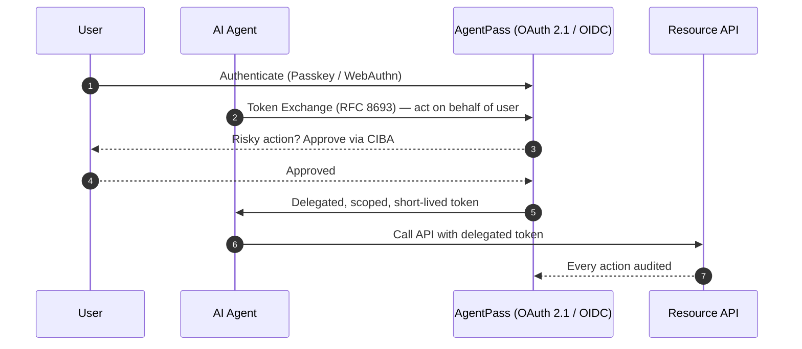

<div align="center">

# Winuka Mahagamage

<a href="https://github.com/WinuMG">
  
</a>

**Computer Science Undergraduate @ University of Colombo School of Computing (UCSC)**
<br/>
Software Engineering Intern candidate · Matara, Sri Lanka 🇱🇰

<p>
  <a href="https://linkedin.com/in/winuka-mahagamage"></a>
  <a href="mailto:winukauni@gmail.com"></a>
  <a href="https://github.com/WinuMG"></a>
  
</p>

</div>

---

### `$ whoami`

```java
public record Engineer(
        String name,
        String role,
        List<String> focus,
        List<String> architectures,
        String currentlyBuilding,
        String openTo
) {
    public static Engineer winuka() {
        return new Engineer(
            "Winuka Mahagamage",
            "CS Undergraduate @ UCSC · Freelance Web Developer",
            List.of("Backend Engineering", "Auth & Identity", "CI/CD & DevOps"),
            List.of("Microservices", "Modular Monolith", "Event-Driven / Saga", "REST"),
            "AgentPass — an OAuth 2.1 / OIDC identity server for AI agents",
            "Software Engineering Internships"
        );
    }
}
```

I build backend systems that hold up in production: services that talk over message brokers, auth layers that check every request, and pipelines that refuse to merge untested code. One of my systems is **live and in daily use at the Road Development Authority, Matara**.

---

### 🛠️ Tech Stack

<table>
  <tr>
    <td><b>Languages</b></td>
    <td></td>
  </tr>
  <tr>
    <td><b>Backend</b></td>
    <td></td>
  </tr>
  <tr>
    <td><b>Data</b></td>
    <td></td>
  </tr>
  <tr>
    <td><b>Messaging</b></td>
    <td>&nbsp;
        
        </td>
  </tr>
  <tr>
    <td><b>Frontend</b></td>
    <td></td>
  </tr>
  <tr>
    <td><b>DevOps</b></td>
    <td></td>
  </tr>
  <tr>
    <td><b>Quality</b></td>
    <td>
      
      
      
      
      
      
    </td>
  </tr>
</table>

---

### 🚧 Currently Building: AgentPass

> **An identity server for AI agents, written from scratch.** AI agents increasingly act *on behalf of* users. AgentPass gives them access that is scoped, time-limited and fully audited, never the user's own credentials.



`Java 21` `Spring Boot` `PostgreSQL` `Redis` `React` `TypeScript` `Python` `Docker` `Kubernetes`

---

### 🏗️ Featured Engineering Work

<table>
<tr>
<td width="50%" valign="top">

#### 🚚 [SwiftTrack](https://github.com/WinuMG/swifttrack)
**Microservices Logistics Platform** · *Grade A*

- Independent **Node.js microservices** behind an **API gateway** with JWT auth
- **Saga orchestration** over **RabbitMQ** keeps distributed order transactions consistent
- **Protocol adapters** connect legacy systems
- Real-time delivery tracking pushed to the React dashboard with **Socket.IO**

`Node.js` `RabbitMQ` `MongoDB` `Docker Compose`

</td>
<td width="50%" valign="top">

#### 🌾 AgriTech Connect
**Farm Management & Agri-Trading Platform**

- **11-module modular monolith** with Spring Modulith
- Stateless **JWT** auth + role-based authorisation via **Spring Security**
- **PostgreSQL + PostGIS** schema, versioned migrations with **Flyway**
- CI/CD: **SonarQube** gates, **JaCoCo** coverage, **Testcontainers**, images published to **GHCR**

`Java 25` `Spring Boot 4` `Valkey` `GitHub Actions`

</td>
</tr>
<tr>
<td width="50%" valign="top">

#### 💼 [TalentPipe](https://github.com/Multi-Tenant-Recruitment-Platform)
**Multi-Tenant SaaS Recruitment Platform** · *UCSC Industry Project*

- **Led the React + TypeScript frontend** in a 5-person Agile team, mentored by a Senior SWE
- JWT auth with **silent token refresh**, **RBAC for 4 roles**, **tenant data-isolation guard**
- Integrated with a **Spring Boot** REST API
- **Vitest** tests and CI through **Docker + GitHub Actions + SonarCloud**

[`frontend`](https://github.com/Multi-Tenant-Recruitment-Platform/talentpipe-frontend) · [`backend`](https://github.com/Multi-Tenant-Recruitment-Platform/talentpipe-backend)

</td>
<td width="50%" valign="top">

#### 🛣️ RDA Matara — Road Projects System
**🟢 Live in production at the Road Development Authority**

- Full-stack platform that monitors road projects run by private contractors and presents them to the public
- **JWT role-based workflows** for engineers, technical officers, supervisors and staff
- Real-time project tracking with **Google Maps API** visualisation
- Containerised with **Docker**, served behind **Nginx**

`React` `Express` `MongoDB` `Nginx`

</td>
</tr>
<tr>
<td width="50%" valign="top">

#### 🍞 Toast Vibes POS
**Restaurant Point-of-Sale System**

- **NestJS** server-side billing with automated reporting and scheduled backups
- Live order and status sync on every dashboard via **WebSockets**
- JWT-secured, role-based dashboards

`NestJS` `TypeScript` `MongoDB` `shadcn/ui`

</td>
<td width="50%" valign="top">

#### ⚽ GoPlay
**Sports Booking & E-Commerce Platform** · *Grade A*

- Built on a **custom PHP MVC framework** with a MySQL relational schema
- **Led the Coach module**: time-slot validation, availability scheduling, earnings analytics, reviews
- PayHere payments, Chart.js analytics

`PHP` `MySQL` `Chart.js` `PayHere`

</td>
</tr>
</table>

---

### 🧠 Engineering Principles

```yaml
architecture:   Choose the simplest structure that scales: modular monolith first, microservices when needed
consistency:    Distributed transactions need sagas, not hope
security:       Deny by default · least privilege · validate every token
quality:        If CI doesn't check it, it isn't guaranteed: tests, coverage gates, static analysis
delivery:       Containerise everything · reproducible builds · migrations are code
```

---

### 📜 Certifications

| Certification | Issuer | Status |
|---|---|---|
| DevOps Fundamentals | IBM | ✅ Jun 2026 |
| API Development | Edureka · Coursera | ✅ Nov 2026 |
| Machine Learning Specialization | DeepLearning.AI & Stanford Online | 🔄 In progress |

---

### 📊 GitHub Activity

<div align="center">
  
  
  <br/>
  
  <br/>
  
</div>

---

<div align="center">

**Open to Software Engineering Internships, especially backend, platform and DevOps roles.**

<a href="mailto:winukauni@gmail.com"></a>

<sub>English · Sinhala</sub>

</div>
